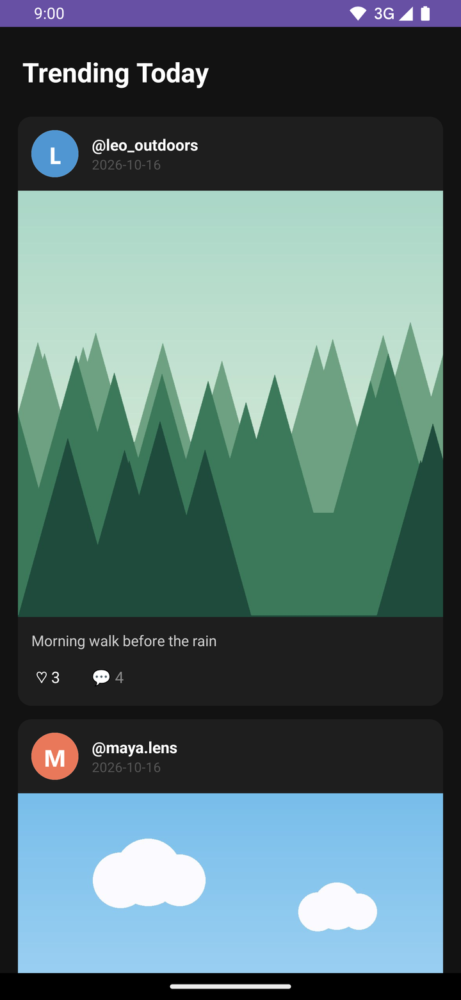
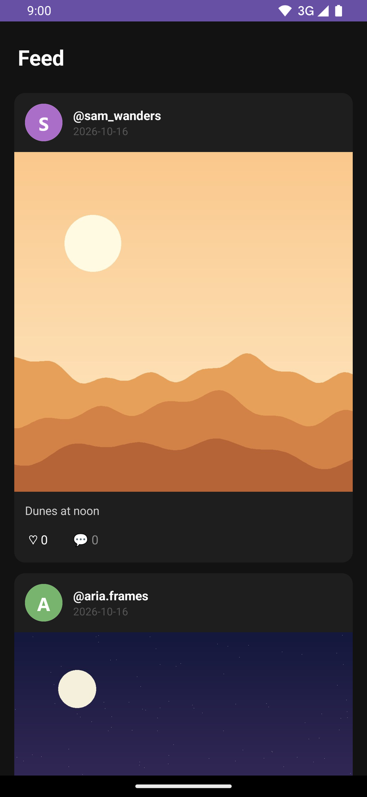
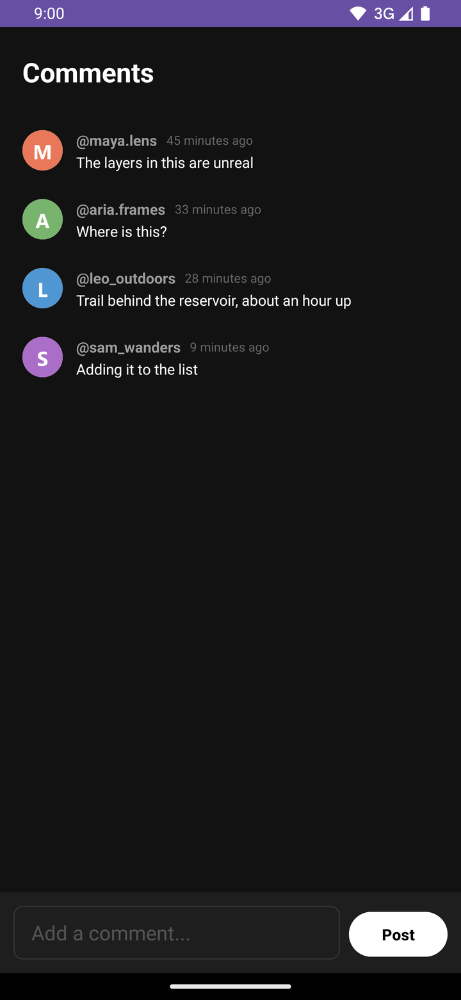
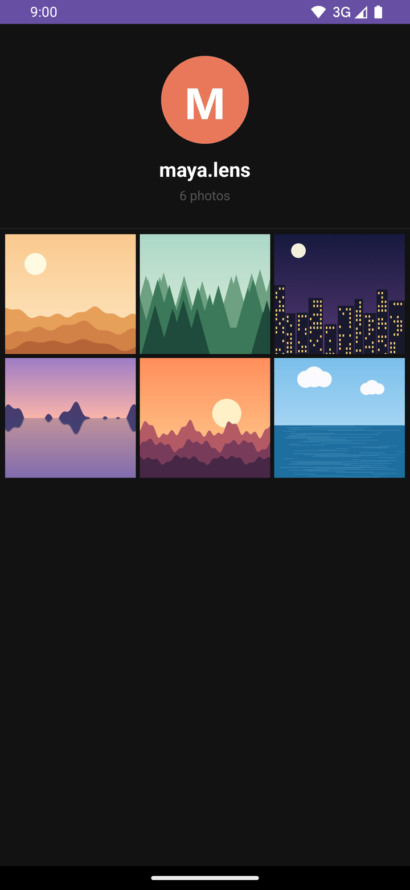
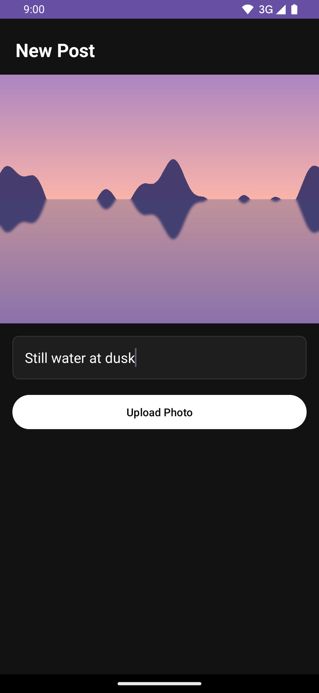
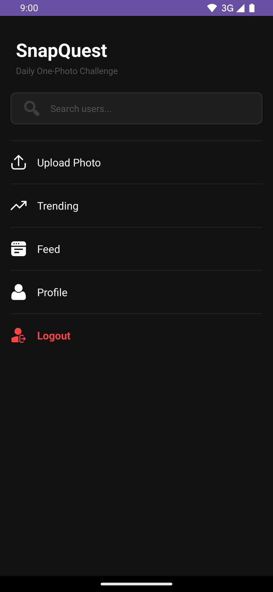
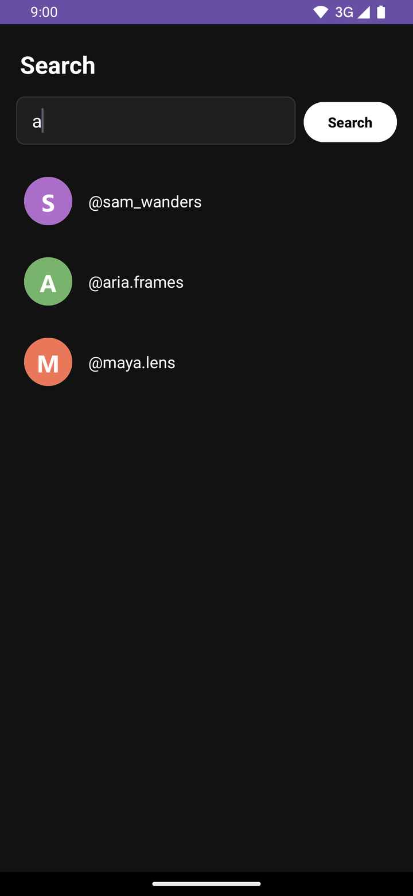
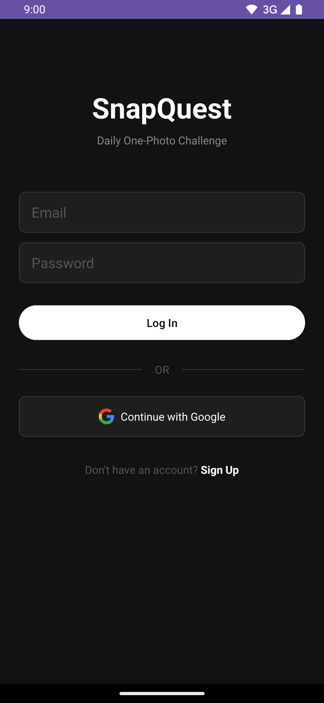
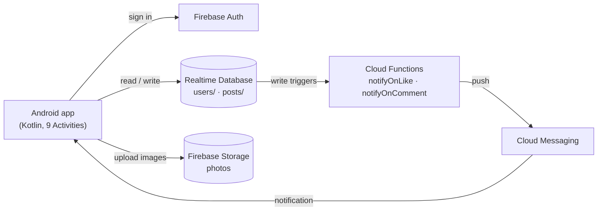

# SnapQuest

An Android social app built around a single constraint: **one photo per day.**

Each user gets one upload per calendar day — no feeds full of filler, no
posting sprees. The app enforces the limit, reminds you if you haven't
posted, and ranks the day's photos by likes. Built as a final-year project.

## The idea

Most photo-sharing apps reward volume. SnapQuest rewards showing up: you
choose one photo, once a day, and so does everyone else. The daily limit
shapes the whole data model — posts are keyed by date, so "has this user
posted today" is a single O(1) lookup rather than a query.

## Screenshots

<table>
  <tr>
    <td align="center"><br><sub>Trending</sub></td>
    <td align="center"><br><sub>Feed</sub></td>
    <td align="center"><br><sub>Comments</sub></td>
    <td align="center"><br><sub>Profile</sub></td>
  </tr>
  <tr>
    <td align="center"><br><sub>Upload</sub></td>
    <td align="center"><br><sub>Home</sub></td>
    <td align="center"><br><sub>Search</sub></td>
    <td align="center"><br><sub>Login</sub></td>
  </tr>
</table>

<sub>Captured from the app running against the local Firebase emulators, with demo accounts and generated images.</sub>

## Features

- **Daily upload limit** — one post per user per calendar day, checked
  before the image picker even opens
- **Email and Google authentication** via Firebase Auth
- **Feed** of all posts, with likes and threaded comments
- **Trending** — today's posts only, ranked by like count
- **Profiles** with a 3-column photo grid and editable profile picture
- **User search** by username
- **Push notifications** when someone likes or comments on your photo,
  delivered by Cloud Functions reacting to database writes
- **Daily reminder** at 20:00 via WorkManager if you haven't posted yet

## Architecture



The client talks to Firebase directly; the only server-side code is the two
notification triggers, which react to database writes so that sending a
push is a side effect of liking or commenting rather than a separate client
call.

## Engineering notes

A few decisions worth calling out:

- **Date-keyed posts.** `posts/{uid}/{YYYY-MM-DD}` turns "has this user
  posted today?" into a single path lookup, and the Storage path
  (`posts/{uid}/{date}.jpg`) mirrors it, so each day maps to exactly one
  image.
- **Atomic counters.** Likes and comment counts are updated with
  `runTransaction` rather than read-then-write, so two people liking at the
  same moment don't lose an increment.
- **Security rules tested against the emulator.** `database.rules.json` was
  checked with the Firebase Database Emulator for both the denied cases
  (unauthenticated access, editing another user's profile, impersonated
  likes/comments) and the exact paths each screen reads and writes, then
  verified end to end on a device against the deployed rules.
- **Documented tradeoffs.** What wasn't done, and why, is written down in
  [`LIMITATIONS.md`](LIMITATIONS.md) rather than left implicit.

## Tech stack

| Layer | Technology |
|---|---|
| Language | Kotlin |
| UI | Android Views (XML layouts), Material 3, RecyclerView |
| Auth | Firebase Auth (email/password + Google Sign-In) |
| Database | Firebase Realtime Database |
| Image storage | Firebase Storage |
| Image loading | Glide |
| Push notifications | Firebase Cloud Messaging + Cloud Functions (Node.js) |
| Background work | WorkManager |
| Build | Gradle 9.2.1, AGP 9.0.1 |

`minSdk 24` · `targetSdk 36`

## Data model

Realtime Database is a single JSON tree. Posts are keyed by user and date,
which is what makes the one-per-day rule cheap to enforce:

```
users/{uid}
  ├── username
  ├── email
  ├── profilePicture      (Storage download URL)
  └── fcmToken            (device token for push)

posts/{uid}/{YYYY-MM-DD}
  ├── imageUrl            (Storage download URL)
  ├── caption
  ├── timestamp
  ├── likes               (counter)
  ├── commentCount        (counter)
  ├── likedBy/{uid}       (true — one entry per user who liked)
  └── comments/{pushId}
        ├── username
        ├── text
        ├── timestamp
        └── userId
```

Storage layout: `posts/{uid}/{YYYY-MM-DD}.jpg` and `profiles/{uid}.jpg`.

Access control lives in [`database.rules.json`](database.rules.json):
profiles are writable only by their owner, posts only by their author, and
likes/comments are open to any signed-in user but validated so a user
cannot impersonate another or edit an existing comment.

## Screens

| Activity | Purpose |
|---|---|
| `MainActivity` | Login (email + Google) |
| `SignupActivity` | Account creation |
| `HomeActivity` | Navigation hub, daily-limit check, reminder scheduling |
| `UploadActivity` | Photo preview, caption, upload |
| `FeedActivity` | All posts |
| `TrendingActivity` | Today's posts, ranked by likes |
| `CommentsActivity` | Comment thread for a post |
| `ProfileActivity` | Profile and photo grid (own or another user's) |
| `SearchActivity` | Find users by username |

## Cloud Functions

Two Realtime Database triggers in [`functions/index.js`](functions/index.js)
send push notifications by watching for writes, so the client never needs
to send notifications itself:

- `notifyOnLike` — fires on a new `likedBy/{uid}` entry
- `notifyOnComment` — fires on a new comment

## Project structure

```
app/src/main/java/com/ashar/snapquest/
  *Activity.kt              one per screen (see table above)
  PostAdapter.kt            feed/trending rows — likes, comment button
  CommentAdapter.kt         comment rows
  GalleryAdapter.kt         profile photo grid
  SearchAdapter.kt          search results
  MyFirebaseMessagingService.kt   receives pushes, stores the FCM token
  ReminderWorker.kt         20:00 "you haven't posted" reminder
functions/index.js          Cloud Functions (push notifications)
database.rules.json         Realtime Database security rules
LIMITATIONS.md              known tradeoffs and next steps
```

## Running it

You'll need:

- Android Studio and JDK 11+
- A Firebase project of your own
- The [Firebase CLI](https://firebase.google.com/docs/cli) and Node.js 24
  (only for deploying rules and functions)

1. **Clone**

   ```bash
   git clone https://github.com/SyedAsharAhmd/SnapQuest.git
   ```

2. **Create a Firebase project** and enable:
   - Authentication → Email/Password and Google sign-in providers
   - Realtime Database
   - Storage
   - Cloud Messaging

   Cloud Functions need the project on the Blaze (pay-as-you-go) plan. The
   app runs without them; you just won't get like/comment notifications.

3. **Register the app's SHA-1** (needed for Google Sign-In). Get your debug
   key's fingerprint and add it under Project settings → Your apps:

   ```bash
   ./gradlew signingReport
   ```

4. **Add your config.** Download `google-services.json` from the Firebase
   console *after* enabling Google sign-in and adding the SHA-1, and replace
   `app/google-services.json`. The committed one points at the original
   project, whose rules will reject your writes.

5. **Point the CLI at your project and deploy the rules and functions**

   ```bash
   firebase use --add            # select your project
   firebase deploy --only database
   cd functions && npm install && cd ..
   firebase deploy --only functions
   ```

   The repo has no Storage rules (see [`LIMITATIONS.md`](LIMITATIONS.md)),
   so set them in the console before using a project anyone else can reach.

6. **Build and run** from Android Studio, or:

   ```bash
   ./gradlew assembleDebug
   ```

On Android 13+ the app doesn't yet request the notification permission at
runtime, so to see push notifications and the daily reminder, enable
notifications for SnapQuest in system settings.

`local.properties` (containing your Android SDK path) is generated by
Android Studio on first open and is intentionally not committed.

## Known limitations

This was built to a final-year-project scope, and the tradeoffs that implies
are documented explicitly in [`LIMITATIONS.md`](LIMITATIONS.md) — including
client-side enforcement of the daily limit, the feed's query shape, counter
integrity, and a prioritized list of what a next iteration would address.

## License

No license specified — all rights reserved.
